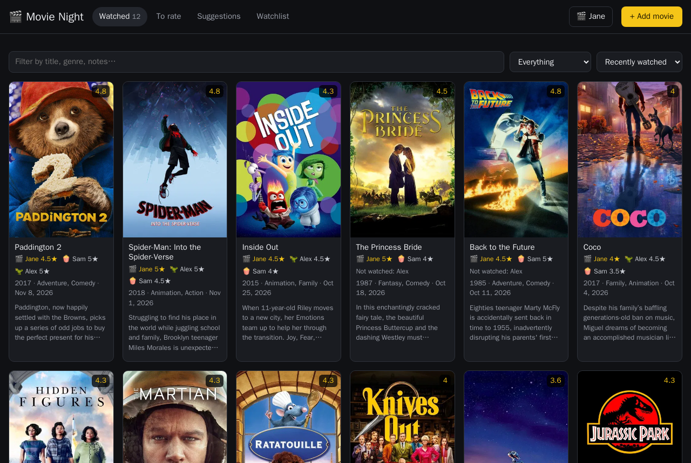
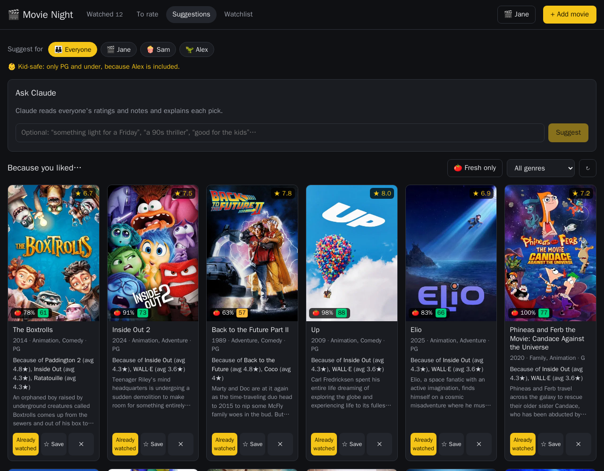
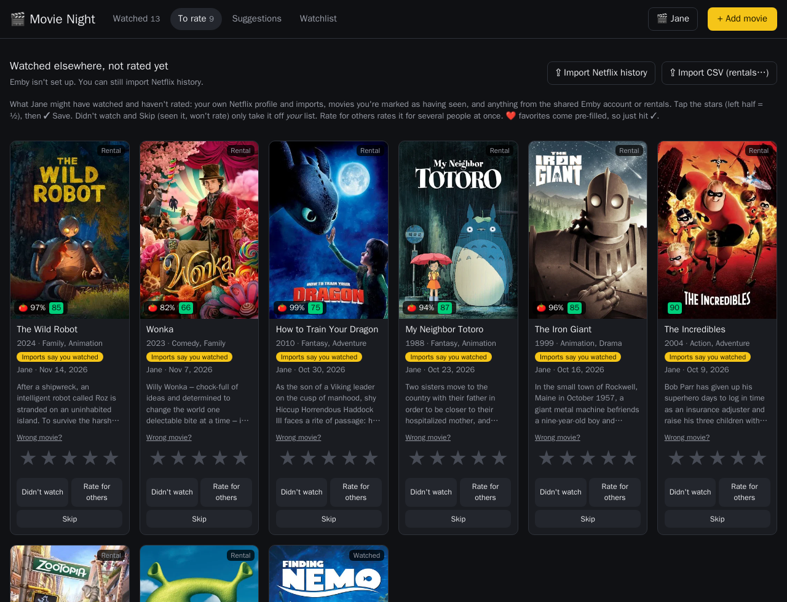

# Movie Night

Log the movies the household has watched. Each person rates separately (1–5 stars, half stars allowed),
then get suggestions for one person or any group watching together.

- **People** (👤 button → Manage people): add each household member. "Also known as" holds their Emby user /
  Netflix profile name (e.g. Jane = `jsmith`) so imported history is credited to them. With a **birthdate**, imported viewings from before
  "count history from age" (default 5) don't count for that person: hidden from their To rate, and not "seen" for suggestions. Each device remembers
  who's rating; tap 👤 to switch. A **kid setting** per person (up to PG-13 / PG / G) keeps every suggestion
  list that includes them within that US rating (from TMDB; movies with no US rating are left out).

- **Watched**: each card shows everyone's rating, who hasn't watched it and the family average. Filter by
  "Rated by me / Needs my rating / I haven't seen"; sort by my rating or family average. Click a card to
  rate it for anyone (one row of stars per person; everyone starts as "Not watched").
- **Suggestions**
  - Pick **who it's for**: Everyone, one person, or any mix. A movie is suggested as long as at least one person in the group hasn't seen it, and the card says who has (with their rating): on your own you never get one you've seen, but add a kid who hasn't and it can show up.
  - *Because you liked…*: TMDB recommendations of every movie the group rated, weighted by the group's
    **average** rating (4+★ pulls up, 2.5★ and under pushes down, so one person's dislike counts against it).
    TMDB's "similar movies" add more candidates. They're looser matches, so each counts for half and only once,
    which keeps them from crowding out the real recommendations. Up to 90 picks are shown.
    For one person, movies another family member rated 4+★ that they haven't seen are included too.
    When a kid is in the group, that bonus counts half, so the kids' own matches come first.
  - *Ask Claude*: sends the whole rated list (with notes) plus an optional mood ("something light for Friday")
    to Claude, which returns 8 picks with a reason for each. For a group it looks for common ground. Uses `claude-opus-5-5` (override with `CLAUDE_MODEL`).
    Each click costs a few cents.
  - With an OMDb key, every movie card (suggestions, watchlist, Watched, To rate) also shows the **Rotten Tomatoes** Tomatometer
    (🍅 fresh at 60%+, 🤢 rotten) and the **Metacritic** Metascore (green 61+, yellow 40–60, red under 40).
    The critics also nudge the ranking: the average of the two scores (or whichever exists) multiplies a
    movie's score, from ×1.2 at 100 down to ×0.7 at 0, with 60 neutral. Your own ratings still matter most;
    critics mostly reorder close calls. For any group with a kid setting the boost is halved (×0.85–×1.1).
    Some movies have no scores on OMDb and are left as they are. **🍅 Fresh only**
    (next to the genre filter) keeps only the Fresh ones in *Because you liked…*; movies with no score are hidden
    too. Each device remembers the setting.

  

- **To rate** is per person: only what that person could have watched and hasn't rated. That's movies credited to them
  (their Netflix profile, imports under their name, Watched movies marked seen), plus movies from shared accounts
  (Emby, rentals) watched after their count-from age. Shared-account movies come first, then ones credited to them, newest first.
  - Every movie marked played in Emby or Jellyfin, or in any account's Plex watch history, lands here, synced every 6 h
    and from the **⟳ Sync** button. "Watched by" and the date come from the server; already-rated or skipped movies
    aren't re-queued, and a movie on more than one server is merged into one entry. Set the servers up in ⚙ Settings.
  - Tap the stars, then **✓ Save** to rate it into Watched for whoever is rating on that device. A ❤ Emby favorite starts at 4.5★.
  - **Didn't watch** takes it off your list and is remembered across syncs. **Rate for others** rates it for several
    people at once. **Skip** still counts as seen, so it's never suggested.
  - Tap the summary to expand it. **Wrong movie?** fixes a bad match (see below).

  

- **Netflix import** (To rate tab → ⇪ Import Netflix history): on netflix.com, Account → Profiles → a profile →
  Viewing activity → *Download all* gives `NetflixViewingHistory.csv`. Upload it per profile and say whose it is.
  TV episodes are skipped; movies are matched to TMDB on exact title (released before the watch date, most-voted
  wins) and queued with the latest watch date. Titles that don't match are listed so you can add them by hand.
  Re-importing is safe, and movies already queued from Emby are merged rather than duplicated.
- **✕ (Not interested)** on a suggestion hides it for the whole household, and counts as a mild dislike: a quarter
  of a 1★ rating's pull on what TMDB links to it. One ✕ barely changes anything, but a pattern of them
  (several animated Batman films, say) sinks similar picks. Ask Claude is told to avoid them and movies like them.
  **Dismissed picks** (link at the bottom of Suggestions) lists them, to bring back one at a time or all at once.
- **Already watched** on any suggestion adds it to Watched with that movie filled in; it then stops being suggested.
- **CSV import** (To rate → ⇪ Import CSV): any list of movies, e.g. rental/purchase history. Upload, check the
  guessed Title / Year / Date columns, pick whose list it is and a label (shown on the cards). Format tags like
  "(4K UHD)", "[HD]", "- Rental" are stripped; a year in the title or a year column picks the right remake.
- **Wrong movie?** (on To rate cards, and in a Watched movie's dialog): search and pick the right one, e.g.
  RoboCop 1987 instead of 2014. Ratings and watchers carry over (merging if the right one is already rated),
  and the fix is remembered so later Emby syncs / Netflix / CSV imports use it. Switching back undoes it.
- **Watchlist**: suggestions saved with ☆ Save, remembered as saved *for* the people selected at the time
  (saving it again with other people selected adds them; ★ Saved means it's saved for everyone selected).
  Rating it, skipping it or pressing Remove only takes it off the list of the people who did; it stays for
  anyone else it was saved for. It has the same "for" chips as Suggestions (one shared selection) and shows
  what was saved for anyone selected, minus what someone selected has already seen and, with a kid included, anything
  over their rating limit. Marking one "Watched it" moves it to Watched. With Radarr set up,
  each card shows whether Radarr has it (✓ Downloaded / ⏳ searching) or a **⬇ Request in Radarr** button that adds it
  (monitored, with a search) using your first quality profile and root folder, or the ones set in `.env`.

## Set up

You need a machine with Docker (with the Compose plugin) and a free TMDB API key. Emby / Jellyfin / Plex, Anthropic, OMDb and Radarr are optional.

    git clone <repo-url> movie-night && cd movie-night
    cp .env.example .env && chmod 600 .env   # keys can go here, or in ⚙ Settings in the app
    docker compose up -d --build              # open http://<this-machine>:8095

Then, in the app:
0. Open **⚙ Settings** (top right) and paste your API keys. **Test** checks each one against the real service.
   Keys saved there take over from `.env` straight away, no restart. They're stored in `data/settings.json`
   (readable only by the app's user, mode 600, and kept out of the database and its backups) and never shown again,
   only their last 4 characters. **Use .env** forgets a saved value. Changing a Radarr / Emby / Jellyfin / Plex URL needs its
   API key typed again, so a changed URL can't be used to send your saved key to some other server.
   At the bottom of Settings you can set a **settings password**. Nobody has to log in to browse or rate, but
   Settings, age limits, birthdates and removing someone then ask for it (unlocking lasts 15 minutes from the last
   change, per browser; 5 wrong guesses pause tries for a minute). Forgot it? On the server, delete the `"_password"`
   line from `data/settings.json`.
   Each person can have a 4-digit **PIN** (🔑 in Manage people). Picking them in **👤 Who's rating?** asks for it once
   per device (the browser remembers, in a signed cookie). You can only change or remove your **own** ratings and marks;
   for others you can still add a first rating or "seen" (handy after a family movie night). With the settings
   password unlocked, a grown-up can change anyone's ratings and reset a forgotten PIN.
1. Tap **👤 Who's rating?** → **Manage people** and add everyone in the household. Add an "also known as" name for
   anyone whose Emby / Jellyfin / Plex user or Netflix profile has a different name, plus a birthdate / kid setting for kids if you like.
2. Pick who's rating on this device, and start adding movies: search in **Watched**, sync your media server, or import
   Netflix / CSV history from the **To rate** tab.
3. Once a few movies are rated, try **Suggestions**.

Port 8095 already taken? Set `PORT=` in `.env`. The app has **no login**: keep it on your home network
(or behind a reverse proxy with authentication), not open to the internet. That matters more now that anyone
who can open it can change the API keys in Settings. Settings covers the keys, URLs, Claude model, Radarr profile/folder
and which media-server users to import; `PORT`, `PUID`/`PGID`, `BACKUP_KEEP` and `EMBY_SYNC_HOURS` stay in `.env`.

After editing `.env` or the code: `docker compose up -d --build`. Data lives in `data/movies.db` (SQLite).

**Backups**: once a day the app writes a verified copy of the database to `data/backups/movies-YYYY-MM-DD.db`
(without the re-downloadable TMDB/OMDb cache, so it's small) and keeps the newest 14 (`BACKUP_KEEP` in `.env`;
0 turns it off). They're on the same disk as the app, so copy that folder somewhere else now and then. To restore:
`docker compose down`, copy a backup over `data/movies.db`, delete `data/movies.db-wal` and `data/movies.db-shm`
if they exist, then `docker compose up -d`.

Keys:
- `TMDB_API_KEY`: free at https://www.themoviedb.org/settings/api. Either the v3 API key or the v4 read token works.
  Without it you can still add movies by hand, but there's no search, posters or "Because you liked".
- `EMBY_URL` / `EMBY_API_KEY`: Emby Dashboard → Advanced → API Keys. Optional `EMBY_USERS=Ben,Jess` to limit
  which Emby users are imported, `EMBY_SYNC_HOURS=0` for button-only.
- `ANTHROPIC_API_KEY`: https://console.anthropic.com/settings/keys. Only needed for Ask Claude.
- `RADARR_URL` / `RADARR_API_KEY` (optional): Radarr → Settings → General → API Key. Optional
  `RADARR_QUALITY_PROFILE` (name or id) and `RADARR_ROOT_FOLDER` pick where requests go.
- `OMDB_API_KEY`: free at https://www.omdbapi.com/apikey.aspx (activate it from the email). Only needed for
  Rotten Tomatoes / Metacritic scores and the critics boost; they're cached for 90 days once a movie has been out a year (14 days for new releases and movies with no score yet), so the free 1,000 lookups a day is plenty (Watched and To rate only look up the cards on screen, a page at a time).

TMDB responses are cached in the DB for 7 days, so the Suggestions tab is fast after the first load.

The container runs the app as an ordinary user, not root, and that user owns `data/`. It defaults to user and
group 1000; if yours differ (`id -u`, `id -g`), set `PUID` / `PGID` in `.env`. `docker ps` shows the container as
healthy once the app answers.

## Tests

    docker compose build
    docker run --rm --entrypoint sh -v "$PWD":/src:ro movie-app:local -c \
      "pip install -q -r /src/requirements-dev.txt && cp -r /src/app.py /src/static /src/tests /tmp/ && cd /tmp && python -m pytest -q tests"

They use a throwaway database and no API keys (TMDB and Radarr are faked), and cover the suggestion scoring,
the kid limit, the per-person watchlist, Netflix/CSV parsing, the critic-score cache and backups.

## Files
- `app.py`: Flask API, scoring (`suggestions()`), Claude prompt (`SYSTEM_PROMPT`, `claude_suggestions()`)
- `static/`: the page (`index.html`, `style.css`, `app.js`)
- `tests/`: the test suite
- `Dockerfile`, `entrypoint.sh`, `compose.yaml`: the container

## Credits

Made by Blake Martin. Movie details, posters and recommendations come from [TMDB](https://www.themoviedb.org/).
This product uses the TMDB API but is not endorsed or certified by TMDB.
Rotten Tomatoes and Metacritic scores come from [OMDb](https://www.omdbapi.com/).

## License

MIT © 2026 Blake Martin. See [LICENSE](LICENSE).
